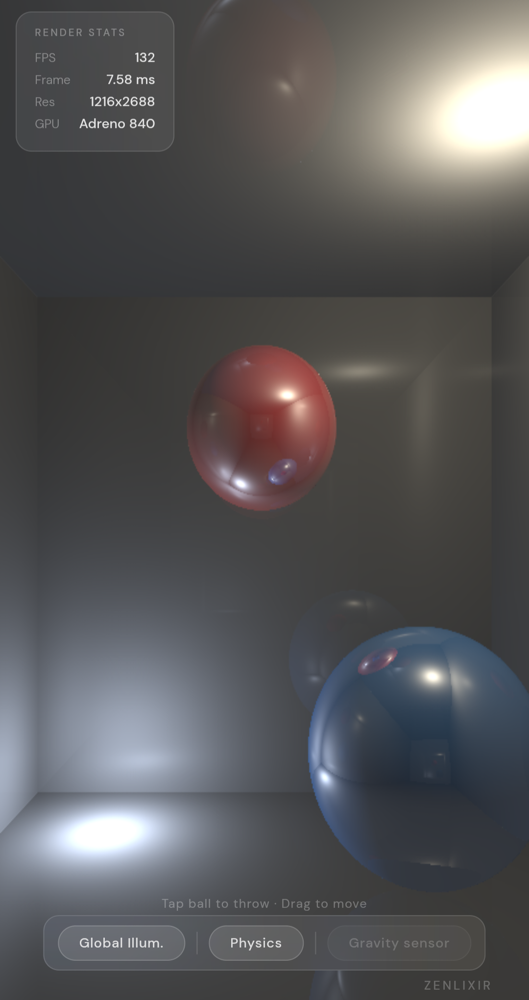
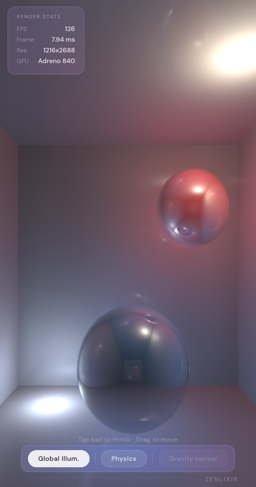

<div align="center">

<h1>WebGL Ray Tracing Test</h1>
<p>Real-time "ray tracing" in WebGL using SDF ray marching.</p>
<p>Reflective balls with drag, throw, and gravity, without turning your device into a baked potato.</p>
</div>
<p align="center">
  <a href="https://github.com/rynekryz/webgl-raytracing-test/stargazers"></a>
  
  
  
  
</p>

<p align="center">
  <a href="https://github.com/rynekryz/webgl-raytracing-test"></a>
</p>

---

## Screenshots

<div align="center">


</div>

---

## Features

- Real-time SDF ray marching
- Really nice reflections
- Some balls
- Drag and throw controls
- Sphere collision physics
- Gravity
- FPS / frame-time overlay
- Pure WebGL + fragment shader
- Can run literally on everything (not really), including an [Aternos](https://aternos.org) server (JK)

---

## Technical Stack

- **Rendering:** WebGL with a GLSL fragment shader
- **Physics:** SDF ray marching and sphere collisions
- **UI:** HTML, CSS and vanilla JavaScript
- **Language:** JavaScript and GLSL
- **Build:** none

---

## Requirements

- PC (optional)

---

## Project Structure

```
webgl-raytracing-test/
├── index.html
├── render.js
├── shaders.glsl
└── ui.css
```

---

## Notes

This isn't actual ray-tracing that uses RT cores, it uses **SDF ray marching**. So the rays are real-time, just not real RTX. But at least it looks good and can run on a potato lol.

<div align="center">
<strong>Made with ♥︎ by Ryne</strong>
</div>
<div align="center">
  <a href="https://discord.gg/YKhWXXhKmC"></a>
  <a href="https://tiktok.com/@rynekryz"></a>
</div>
